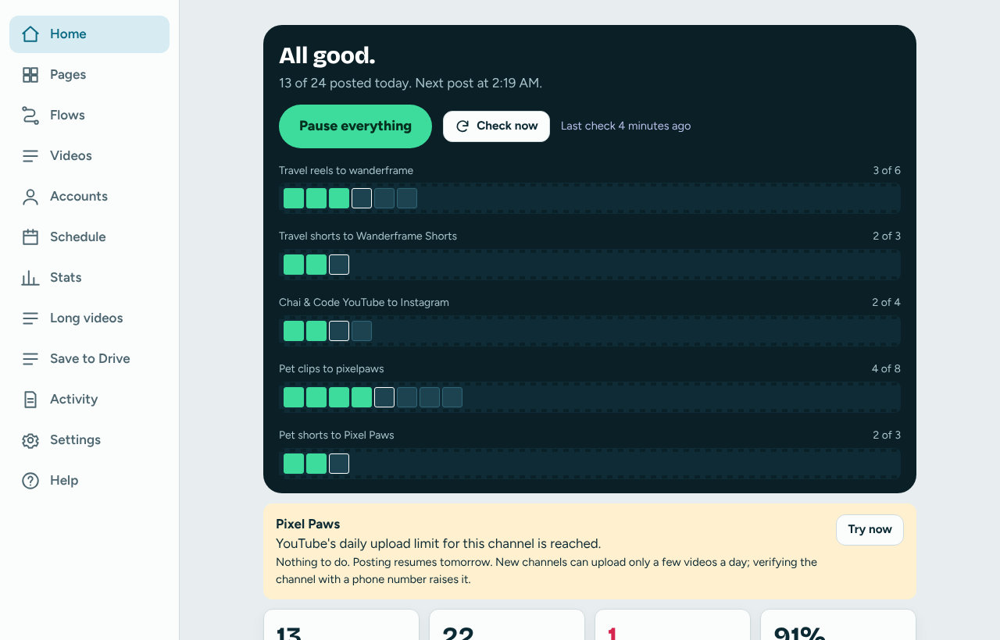

<div align="center">


# Reelio

**Your videos post themselves.**
Schedule Instagram Reels and YouTube Shorts for every page and channel you run. It keeps going while your phone and laptop are off.

[Live demo](https://krvats.github.io/reelio/app.html?demo=1) · [Website](https://krvats.github.io/reelio/) · [Setup guide](docs/SETUP_CHECKLIST.md) · [Selling guide](docs/SELLING.md)



</div>

## What it does

- **Many pages, one screen.** Every Instagram page and YouTube channel with today's progress. Bulk pause, resume and posts-a-day.
- **Any source to any target.** Google Drive, YouTube channels or chosen videos, Instagram pages, or uploads, going to Instagram Reels or YouTube Shorts.
- **Full control per post.** Up to 100 posts a day, time windows, days of the week, days off, natural jitter, per-video captions, move, skip, post now.
- **Captions and looks.** Fixed, random or table captions, hashtag sets, filters, blur/crop/pad fit, watermark, cover frame.
- **Never twice, never lost.** A permanent ledger stops duplicates (by id and file hash). One bad video never blocks a queue.
- **Long videos and Save to Drive.** Cut hour-long videos and live streams into clips; copy videos you may use into Drive.
- **Keeps itself running.** Late GitHub schedules are detected and restarted; blocked YouTube downloads rotate through a pool of saved cookies.
- **Plain-language help.** Every failure says why and what to tap. Telegram alerts. Stats with best posting hours.
- **Private.** Logins are encrypted (AES-256-GCM, PBKDF2) in the browser before they are saved. Official APIs only.
- **Made for phones.** Installable app, light and dark, text size, key screens in Hindi, command palette (Ctrl/Cmd+K).

## Try it without signing in

Open `app.html?demo=1` on the site. It runs the real screens on sample data in your browser. Nothing is saved or posted.

## How it is built

| Part | Where | Notes |
|---|---|---|
| Website | `web/index.html`, `site.css`, `site.js` | Static, no build, self-hosted fonts |
| App | `web/app.html`, `web/js/` | Vanilla ES modules, PWA, demo mode |
| Worker | `worker/reelio/` | Python 3.12, runs on GitHub Actions every 5 minutes |
| Data | private repo `reelio-data` | Settings, queues, ledger, encrypted logins |
| Optional services | `license/`, `api/`, `keepalive/` | Cloudflare Workers: access control, hosted accounts, extra wake-ups |

## Setup (about 15 minutes, once)

Follow [docs/SETUP_CHECKLIST.md](docs/SETUP_CHECKLIST.md) or the setup screen inside the app. In short: publish this repo with Pages set to GitHub Actions, create a private `reelio-data` repo, make a GitHub key, add the secrets `DATA_PAT` and `REELIO_KEY`, then connect your accounts in the app.

The site's "Message us" buttons open an Instagram DM to @kr5na_ (set in `web/app-config.js`).

## Honest limits

- Instagram allows 100 API posts per 24 hours per account. New YouTube projects upload about 6 videos a day.
- GitHub's schedule is best effort and can be late; Reelio catches up the same day.
- Only post videos you own or have permission to use.

## Development

```
cd worker && python -m unittest discover -s tests     # worker tests against fake Instagram/Drive/YouTube servers
cd license && node --test test/                       # access service tests
python tools/screens.py                                # regenerate screenshots and site images (needs Playwright)
```

For contributors and AI assistants: read [CLAUDE.md](CLAUDE.md) first.

## Licence

All rights reserved. The source is visible, but nobody may run, copy or sell it without written permission. See [LICENSE](LICENSE) and [docs/SELLING.md](docs/SELLING.md). Access: [Instagram @kr5na_](https://ig.me/m/kr5na_).
